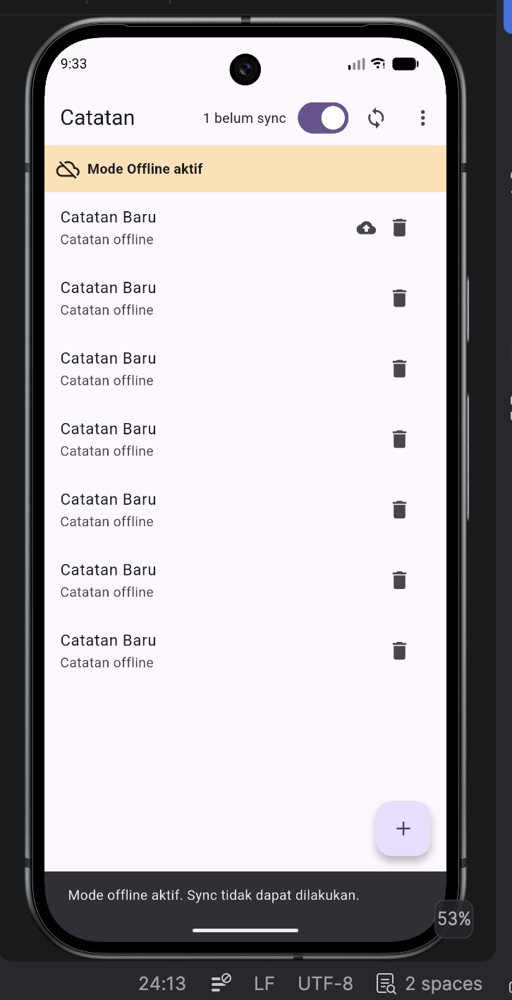
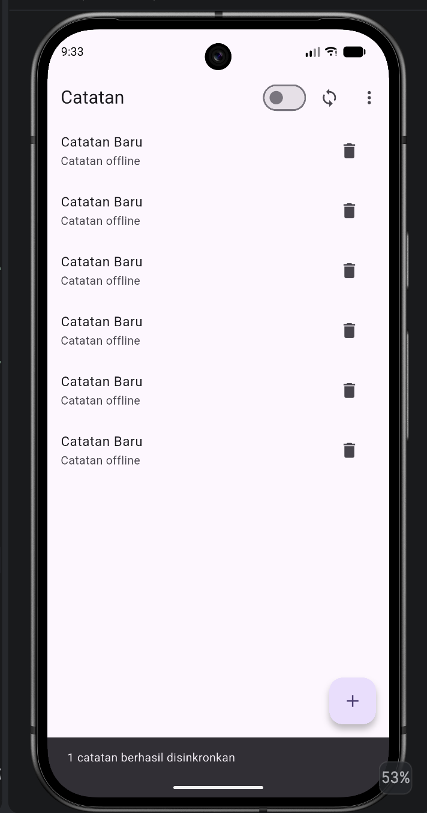
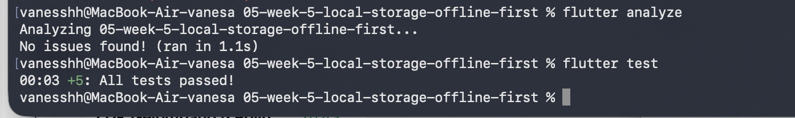

# Laporan Praktikum Offline-First Notes - Week 5

# Identitas

**Nama:** Vanesa Mardiana Putri  
**NIM:** 244107020129  
**Mata Kuliah:** Mobile Course — Week 5 (Local Storage & Offline-First)

Aplikasi Flutter **Offline Notes**: CRUD catatan + preferensi tema + sinkronisasi offline-first.

## Pendahuluan

Aplikasi ini mendemonstrasikan 3 pola offline-first:
1. **SharedPreferences** - penyimpanan key-value lokal
2. **SQLite + Repository** - catatan terstruktur dengan flag sync
3. **Cache-first + Simulasi Sync** - data dari API dengan fallback cache lokal

---

## Praktikum 1: SharedPreferences ✓

### Implementasi
- File: `lib/data/prefs.dart`
- Key tersentralisasi (`dark_mode`, `last_opened_at`)
- Provider: `prefsRepositoryProvider` di `lib/main.dart`
- Notifier: `DarkModeNotifier` dengan async state management

### Hasil
- Dark mode toggle berfungsi dan tersimpan lokal
- Last opened timestamp tercatat (persiapan untuk week 6)

---

## Praktikum 2: SQLite + Repository ✓

### Implementasi
- Model: `lib/data/local/note.dart`
  - Field `dirty` menandai catatan belum tersinkronkan
  - Serialisasi ke/dari SQLite dengan tipe INTEGER untuk boolean
  
- Database: `lib/data/local/db.dart`
  - Tabel `notes`: id, title, body, updated_at, dirty
  - Tabel `cached_posts`: id, payload, cached_at
  
- Repository: `lib/data/repositories/note_repository.dart`
  - Injeksi `openDb` untuk testing (in-memory db)
  - CRUD: `fetchNotes()`, `addNote()`, `deleteNote()`
  - Sync methods: `countDirty()`, `markAllSynced()`

### Hasil
- Catatan tersimpan lokal, tetap ada saat offline
- Badge menampilkan jumlah catatan belum sync (`dirty`)
- Tidak ada akses database langsung di widget (proper separation of concerns)

---

## Praktikum 3: Cache-First + Sync ✓

### Part 1: Cache-First untuk API Posts
- File: `lib/data/sync_service.dart`
- Class: `Post` (model dari JSONPlaceholder)
- Fungsi:
  - `readCachedPosts()` - baca dari tabel `cached_posts`
  - `fetchPostsFromApi()` - GET ke `/posts`
  - `saveCachedPosts()` - simpan hasil ke SQLite
  - `refreshPostsInBackground()` - fetch tanpa blocking UI
  - `loadPostsCacheFirst()` - return cache + background refresh

### Part 2: Sinkronisasi Deterministik
- Fungsi: `syncNotes(NoteRepository repo)`
  - Cek jumlah dirty: `countDirty()`
  - Simulasi upload dengan delay 1 detik
  - Tandai semuanya synced: `markAllSynced()`
  - Return jumlah catatan yang di-sync

### Part 3: Offline Toggle
- File: `lib/providers/connectivity_provider.dart`
- Provider: `forceOfflineProvider`
- Fungsi: simulasi mode offline untuk demo tanpa bergantung Wi-Fi

### Testing Manual

#### Skenario 1: Catatan tetap tampil saat offline
```
1. Buat 1-2 catatan baru (otomatis dirty=1)
2. Aktifkan toggle "offline" di halaman notes
3. Lihat badge: "2 belum sync"
4. Tutup dan buka ulang app
→ Catatan masih ada, badge tetap akurat
```

#### Skenario 2: Sync menghilangkan dirty flag
```
1. Catatan dalam status "belum sync" (badge > 0)
2. Matikan toggle offline
3. Tekan tombol sync ⟳
4. Hasil: "X catatan berhasil disinkronkan", badge → 0
```

#### Skenario 3: Cache posts tetap ada offline
```
1. (Asumsi cached_posts sudah diisi dari sinkronisasi sebelumnya)
2. Aktifkan offline mode
3. Buka screen posts (jika ada)
→ Tetap menampilkan cache, tidak blank
```

---

## Struktur Project

```
lib/
├── main.dart                          # App entry, darkModeProvider
├── data/
│   ├── prefs.dart                     # SharedPreferences repository
│   ├── sync_service.dart              # Cache-first + Sync logic
│   ├── local/
│   │   ├── db.dart                    # Database initialization
│   │   └── note.dart                  # Model + serialization
│   └── repositories/
│       └── note_repository.dart       # CRUD + dirty count
├── pages/
│   ├── notes_page.dart                # UI notes dengan offline toggle
│   └── settings_page.dart             # Dark mode settings
└── providers/
    └── connectivity_provider.dart     # forceOfflineProvider
```

---

## Aturan Conflict Resolution

**Strategi**: Last-Write-Wins (LWW) berdasarkan field `updated_at`

Lihat detail: [CONFLICT_RESOLUTION.md](CONFLICT_RESOLUTION.md)

---

## Dependencies

- `flutter_riverpod` - state management
- `shared_preferences` - simple key-value store
- `sqflite` - database lokal
- `path` - path utilities untuk database
- `dio` - HTTP client untuk API posts

---

## Hasil Aplikasi






---

## Validasi

- `flutter analyze lib` → berhasil
- `flutter test` → berhasil

---

## Kesimpulan

Aplikasi ini telah mendemonstrasikan:
✓ Offline-first notes dengan SQLite + dirty flag  
✓ Dark mode dengan SharedPreferences  
✓ Cache-first pattern untuk API data  
✓ Simulasi sync dengan deterministic offline mode  
✓ Proper separation of concerns (Repository, Service, UI)  

Siap untuk integrasi backend nyata di praktikum berikutnya.

---

## Refleksi

### 1) Mengapa daftar catatan tidak boleh disimpan di SharedPreferences?
Daftar catatan bukan data primitif satu-satu. Catatan berisi banyak item, perlu diurutkan, diubah, dihapus, dan dicari berdasarkan `id` serta `updated_at`. SharedPreferences dirancang untuk key-value sederhana seperti `dark_mode`, `last_opened_at`, atau flag boolean. Jika daftar catatan disimpan di sana, biasanya kita harus serialisasi seluruh list ke JSON lalu parse ulang setiap kali. Ini membuat:

- update data lebih rumit dan rawan error
- pencarian dan pengurutan menjadi tidak efisien
- data mudah rusak saat ukuran bertambah
- sulit menjaga konsistensi `dirty` dan `updated_at` saat sync
- testing dan debugging lebih sulit karena data tidak terstruktur

Jika aturan ini dilanggar, maka aplikasi akan rentan terhadap data-corruption, performa menurun saat jumlah catatan banyak, dan logika sync menjadi tidak dapat diandalkan. Untuk 1000+ catatan, SharedPreferences bukan pilihan yang aman.

### 2) Kapan cache-first cukup, dan kapan membutuhkan strategi lain?
Cache-first cukup jika data bersifat read-heavy dan toleran terhadap stale data untuk beberapa saat, misalnya catatan pribadi, konten artikel draft, atau daftar produk yang tidak perlu berubah tiap detik. Strategi ini cocok untuk UX yang harus tetap bisa dipakai saat offline dan tidak memaksa user menunggu network.

Namun, untuk data harga real-time, kurs valuta, stock barang, atau status pemesanan yang berubah cepat, network-first atau stale-while-revalidate lebih tepat. Dalam kondisi seperti itu, data lama bisa menyesatkan. Artinya, aplikasi harus mencoba network dulu, lalu menampilkan data terbaru jika tersedia, sementara cache hanya dipakai sebagai fallback jika offline.

### 3) Bagaimana dirty flag berubah menjadi antrean sync tanpa memblokir UI?
Dirty flag adalah tanda bahwa catatan perlu dikirim ke server. Di level aplikasi, kita tidak memblokir UI dengan operasi upload besar. Kita cukup menandai catatan dengan `dirty = 1` dan `updated_at`, lalu membiarkan proses sync berjalan di background. Saat user membuka/menutup aplikasi, query `countDirty()` bisa digunakan untuk menampilkan badge dan memberi status “belum sync”.

Saat koneksi balik normal, service sync memproses item dirty satu per satu atau dalam batch tanpa menggangu thread utama UI. Proses ini tetap responsif karena tidak menunggu sinkronisasi selesai untuk user melanjutkan aktivitas. Praktik ini memindahkan pekerjaan berat ke background worker atau async task, sementara UI hanya mengelola status dan notifikasi.

Antrean terpisah (misalnya tabel `outbox`) menjadi perlu ketika:
- banyak operasi terjadi dalam waktu singkat
- aplikasi bisa ditutup tiba-tiba saat koneksi tidak stabil
- user membuat edit cepat dalam beberapa langkah
- kita perlu memastikan semua perubahan tersimpan dan dikirim secara berurutan
- proses sync harus aman dari crash dan retry otomatis

Dengan outbox, operasi yang gagal dikirim tetap ada di local queue sampai berhasil. Ini lebih aman daripada hanya mengandalkan `dirty` flag di tabel utama jika skenario multi-device atau data berubah cepat.

### 4) Bagian mana dari rekomendasi AI yang Anda tolak, dan mengapa?
Saya menolak klaim bahwa seluruh data aplikasi harus dimasukkan ke SharedPreferences atau bahwa SQLite tidak cocok untuk kebutuhan “offline-first” secara umum. Dalam proyek ini, SharedPreferences hanya sesuai untuk preferensi kecil dan flag global, bukan catatan. Selain itu, saya menolak klaim bahwa sqflite “tidak bisa real-time” tanpa konte: memang tidak punya stream native otomatis seperti Drift atau Hive, tetapi untuk kebutuhan CRUD lokal dan dirty queue, sqflite sudah cukup dan lebih simpel.

Saya juga tidak setuju dengan anggapan bahwa real-time native harus selalu dipilih. Dalam aplikasi notes, persyaratan utama adalah keandalan, struktur data, dan sinkronisasi yang dapat diprediksi, bukan sekadar stream live. Drift memang unggul untuk reaktivitas dan type-safety, tetapi untuk praktik ini sqflite lebih sesuai karena lebih ringkas dan mengikuti contoh yang diajarkan di kelas.

Secara umum, rekomendasi AI yang benar adalah:
- SharedPreferences untuk preferensi, bukan catatan
- SQLite/sqflite untuk data catatan dan antrean sync
- Drift jika proyek berkembang ke kebutuhan reaktivitas, relasi, dan testing yang lebih intensif

Dengan demikan, pilihan teknologi harus dilihat dari kebutuhan nyata, bukan sekadar “lebih modern” atau “lebih canggih”.
