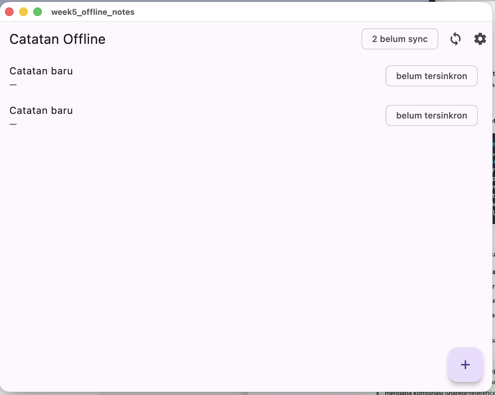
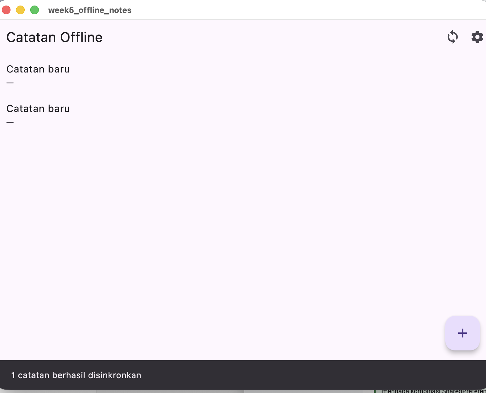
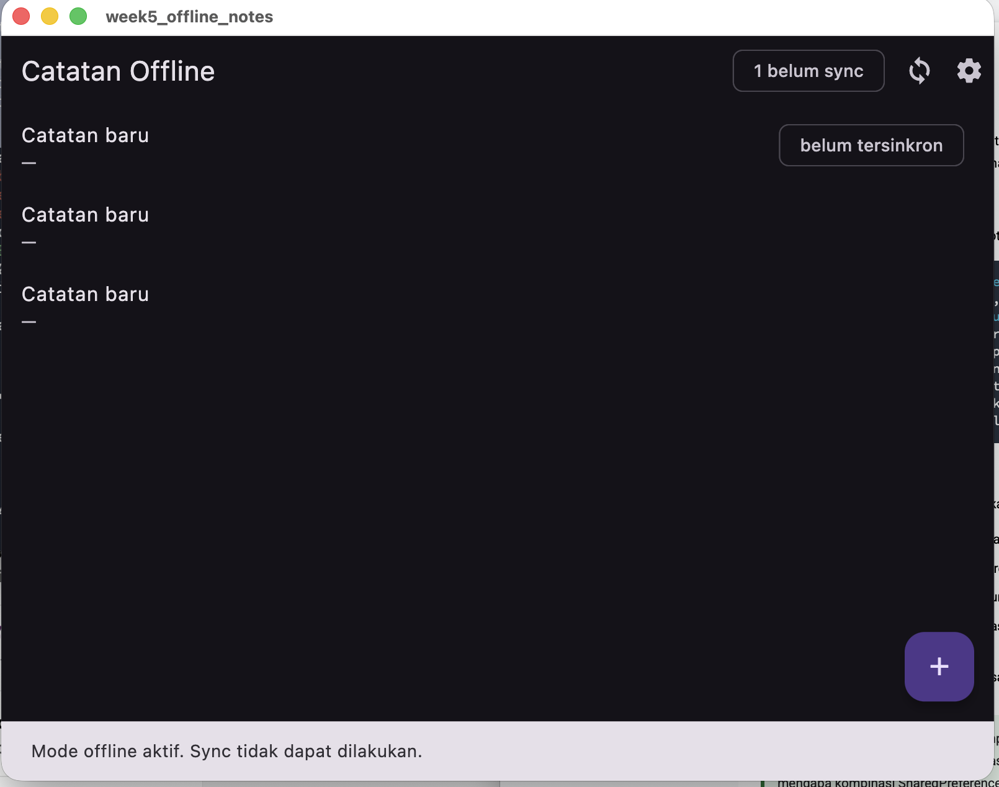
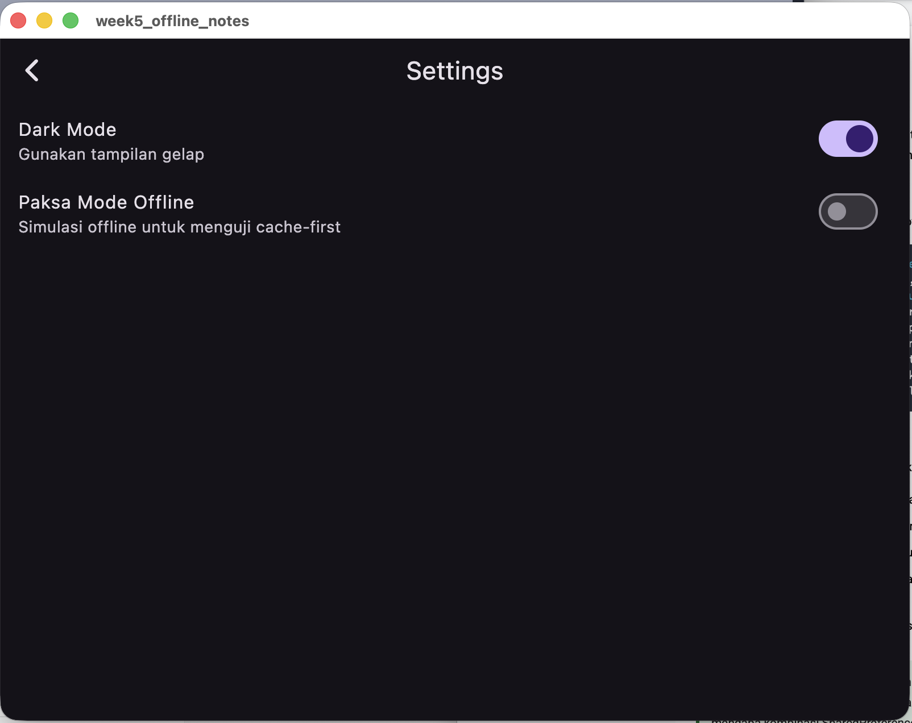

# AI Prompt Challenge

## Prompt
> Aplikasi Flutter Offline Notes: CRUD catatan + preferensi tema. Bandingkan SharedPreferences, Hive, sqflite, dan Drift untuk dua kebutuhan ini. Kriteria: kompleksitas query, relasi, reaktivitas, type-safety, boilerplate, testing. Rekomendasi final + skema 1000+ catatan + trade-off.

## Perbandingan

| Kriteria | SharedPreferences | Hive | sqflite | Drift |
|----------|-------------------|------|---------|-------|
| Query | Tidak ada | Box sederhana | SQL penuh + INDEX | SQL + type-safe |
| Relasi | Tidak | Tidak | FOREIGN KEY | FK + pivot |
| Stream | Tidak | `box.watch()` | Tidak | `watch()` native |
| Type-safety | Lemah | Sedang | Lemah | Kuat |
| Boilerplate | Sangat kecil | Kecil | Sedang | Besar |
| Testing | Sulit | Sedang | Sedang | Mudah |

## Rekomendasi Final

| Kebutuhan | Pilihan | Alasan |
|-----------|---------|--------|
| Preferensi | SharedPreferences | 2 key saja, tidak butuh query/relasi/stream |
| Catatan | sqflite | Butuh ORDER BY, index 1000+ baris, kolom dirty/updated_at untuk sync |

## Skema Tabel

```sql
CREATE TABLE notes(
  id INTEGER PRIMARY KEY AUTOINCREMENT,
  title TEXT NOT NULL,
  body TEXT NOT NULL DEFAULT '',
  updated_at TEXT NOT NULL,
  dirty INTEGER NOT NULL DEFAULT 0
);
CREATE INDEX idx_notes_updated_at ON notes(updated_at DESC);
CREATE INDEX idx_notes_dirty ON notes(dirty) WHERE dirty = 1;
```

## Trade-off

**SharedPreferences**
- Plus: setup cepat, boilerplate minimal, cocok untuk data primitif.
- Minus: tidak query/sort, tidak type-safe, rapuh untuk koleksi (harus serialisasi JSON manual).
- Pakai untuk: preferensi, flag, timestamp.

**Hive**
- Plus: cepat, ada `box.watch()`, ringkas, type-safe via `@HiveType`.
- Minus: tanpa index/join, sorting manual di memori, ekosistem lebih kecil.
- Pakai untuk: koleksi kecil-menengah yang butuh reaktivitas sederhana.

**sqflite**
- Plus: SQL penuh, index, transaksi, matang, ukuran efisien.
- Minus: query string, mapping manual, tanpa stream native.
- Pakai untuk: data terstruktur dengan query kompleks — proyek ini.

**Drift**
- Plus: type-safe, `watch()` native, testing mudah, migrasi terstruktur.
- Minus: boilerplate besar (`build_runner`), learning curve, binary lebih besar.
- Pakai untuk: proyek jangka panjang dengan reaktivitas + relasi.

## AI Verification Checklist

| # | Pertanyaan | Temuan |
|---|-----------|--------|
| 1 | Apakah AI menempatkan daftar catatan di SharedPreferences? | Tidak. Catatan disimpan di sqflite. SharedPreferences hanya untuk `dark_mode` dan `last_opened_at`. |
| 2 | Apakah skema mendukung antrean sync (`dirty`/`updated_at`)? | Ya. Kolom `dirty INTEGER` + `updated_at TEXT` + partial index `idx_notes_dirty`. `countDirty()` dan `markAllSynced()` sudah diimplementasikan. |
| 3 | Apakah klaim "real-time" didukung stream? | Tidak sepenuhnya. sqflite tanpa stream native; proyek pakai `ref.invalidate(notesProvider)` manual. Untuk real-time asli perlu Drift (`watch()`) atau Hive (`box.watch()`). |
| 4 | Apakah estimasi boilerplate masuk akal? | Ya. sqflite ~60 baris repo + ~25 baris db. Drift 2–3× lebih banyak karena generated code + `build_runner`. |
| 5 | Keputusan final | Setuju: SharedPreferences untuk preferensi, sqflite untuk catatan. Pertimbangkan Drift jika butuh reaktivitas native di iterasi berikutnya. |

## Screenshot Hasil





