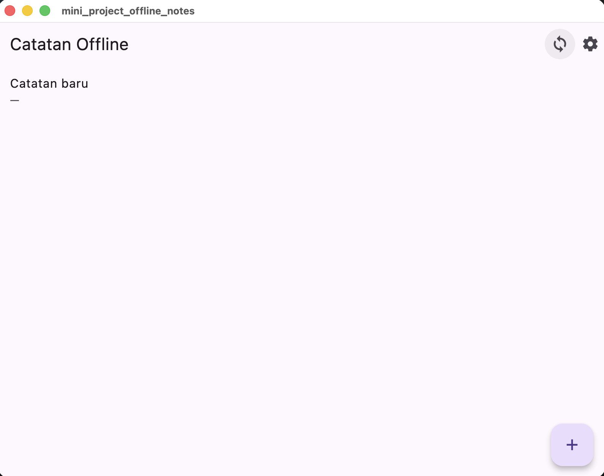
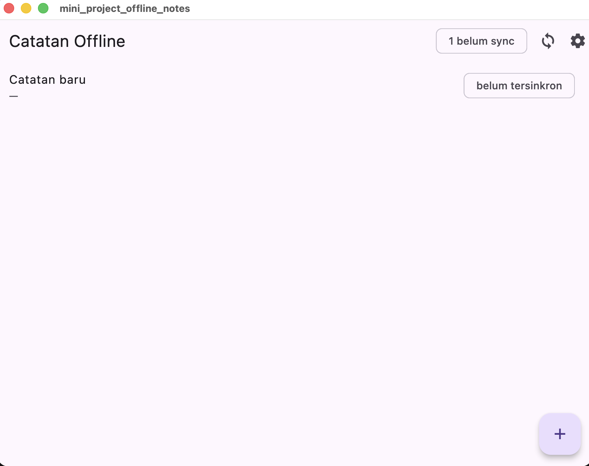

# Laporan Praktikum Offline-First Notes - Week 5

## Pendahuluan

Aplikasi ini mendemonstrasikan 3 pola offline-first:
1. **SharedPreferences** - penyimpanan key-value lokal
2. **SQLite + Repository** - catatan terstruktur dengan flag sync
3. **Cache-first + Simulasi Sync** - data dari API dengan fallback cache lokal

---

## Praktikum 1: SharedPreferences ✓

### Implementasi
- File: `lib/data/prefs.dart`
- Key tersentralisasi (`dark_mode`, `last_opened_at`)
- Provider: `prefsRepositoryProvider` di `lib/main.dart`
- Notifier: `DarkModeNotifier` dengan async state management

### Hasil
- Dark mode toggle berfungsi dan tersimpan lokal
- Last opened timestamp tercatat (persiapan untuk week 6)

---

## Praktikum 2: SQLite + Repository ✓

### Implementasi
- Model: `lib/data/local/note.dart`
  - Field `dirty` menandai catatan belum tersinkronkan
  - Serialisasi ke/dari SQLite dengan tipe INTEGER untuk boolean
  
- Database: `lib/data/local/db.dart`
  - Tabel `notes`: id, title, body, updated_at, dirty
  - Tabel `cached_posts`: id, payload, cached_at
  
- Repository: `lib/data/repositories/note_repository.dart`
  - Injeksi `openDb` untuk testing (in-memory db)
  - CRUD: `fetchNotes()`, `addNote()`, `deleteNote()`
  - Sync methods: `countDirty()`, `markAllSynced()`

### Hasil
- Catatan tersimpan lokal, tetap ada saat offline
- Badge menampilkan jumlah catatan belum sync (`dirty`)
- Tidak ada akses database langsung di widget (proper separation of concerns)

---

## Praktikum 3: Cache-First + Sync ✓

### Part 1: Cache-First untuk API Posts
- File: `lib/data/sync_service.dart`
- Class: `Post` (model dari JSONPlaceholder)
- Fungsi:
  - `readCachedPosts()` - baca dari tabel `cached_posts`
  - `fetchPostsFromApi()` - GET ke `/posts`
  - `saveCachedPosts()` - simpan hasil ke SQLite
  - `refreshPostsInBackground()` - fetch tanpa blocking UI
  - `loadPostsCacheFirst()` - return cache + background refresh

### Part 2: Sinkronisasi Deterministik
- Fungsi: `syncNotes(NoteRepository repo)`
  - Cek jumlah dirty: `countDirty()`
  - Simulasi upload dengan delay 1 detik
  - Tandai semuanya synced: `markAllSynced()`
  - Return jumlah catatan yang di-sync

### Part 3: Offline Toggle
- File: `lib/providers/connectivity_provider.dart`
- Provider: `forceOfflineProvider`
- Fungsi: simulasi mode offline untuk demo tanpa bergantung Wi-Fi

### Testing Manual

#### Skenario 1: Catatan tetap tampil saat offline
```
1. Buat 1-2 catatan baru (otomatis dirty=1)
2. Aktifkan toggle "offline" di halaman notes
3. Lihat badge: "2 belum sync"
4. Tutup dan buka ulang app
→ Catatan masih ada, badge tetap akurat
```

#### Skenario 2: Sync menghilangkan dirty flag
```
1. Catatan dalam status "belum sync" (badge > 0)
2. Matikan toggle offline
3. Tekan tombol sync ⟳
4. Hasil: "X catatan berhasil disinkronkan", badge → 0
```

#### Skenario 3: Cache posts tetap ada offline
```
1. (Asumsi cached_posts sudah diisi dari sinkronisasi sebelumnya)
2. Aktifkan offline mode
3. Buka screen posts (jika ada)
→ Tetap menampilkan cache, tidak blank
```

---

## Struktur Project

```
lib/
├── main.dart                          # App entry, darkModeProvider
├── data/
│   ├── prefs.dart                     # SharedPreferences repository
│   ├── sync_service.dart              # Cache-first + Sync logic
│   ├── local/
│   │   ├── db.dart                    # Database initialization
│   │   └── note.dart                  # Model + serialization
│   └── repositories/
│       └── note_repository.dart       # CRUD + dirty count
├── pages/
│   ├── notes_page.dart                # UI notes dengan offline toggle
│   └── settings_page.dart             # Dark mode settings
└── providers/
    └── connectivity_provider.dart     # forceOfflineProvider
```

---

## Aturan Conflict Resolution

**Strategi**: Last-Write-Wins (LWW) berdasarkan field `updated_at`

Lihat detail: [CONFLICT_RESOLUTION.md](CONFLICT_RESOLUTION.md)

---

## Dependencies

- `flutter_riverpod` - state management
- `shared_preferences` - simple key-value store
- `sqflite` - database lokal
- `path` - path utilities untuk database
- `dio` - HTTP client untuk API posts

---

## Kesimpulan

Aplikasi ini telah mendemonstrasikan:
✓ Offline-first notes dengan SQLite + dirty flag  
✓ Dark mode dengan SharedPreferences  
✓ Cache-first pattern untuk API data  
✓ Simulasi sync dengan deterministic offline mode  
✓ Proper separation of concerns (Repository, Service, UI)  

Siap untuk integrasi backend nyata di praktikum berikutnya.

## Hasil Aplikasi




---
