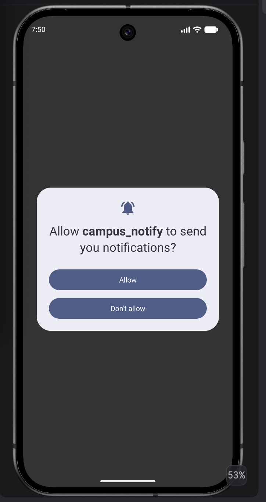
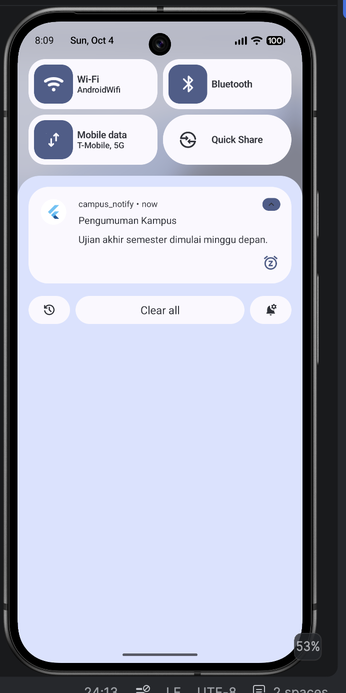
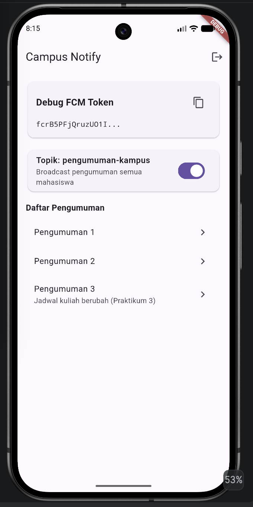
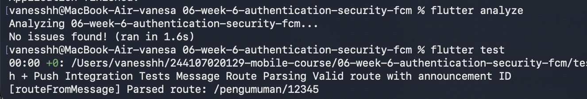

# Campus Notify

Aplikasi mobile Flutter untuk pengumuman kampus dengan autentikasi aman dan push notification menggunakan Firebase Cloud Messaging (FCM).

## Identitas

| | |
|---|---|
| Nama | Vanesa Mardiana Putri |
| NIM | 244107020129 |
| Kelas | TI-3G |


## Daftar Isi

1. [Fitur Utama](#fitur-utama)
2. [Tech Stack](#tech-stack)
3. [Struktur Proyek](#struktur-proyek)
4. [Cara Menjalankan](#cara-menjalankan)
5. [Praktikum 1: Login, Secure Storage, Token Refresh](#praktikum-1-login-secure-storage-token-refresh)
6. [Praktikum 2: FCM, Permission, Token Lifecycle](#praktikum-2-fcm-permission-token-lifecycle)
7. [Praktikum 3: Payload, Tiga App State, Topic](#praktikum-3-payload-tiga-app-state-topic)
8. [Refactoring dan Testing](#refactoring-dan-testing)
9. [Refleksi](#refleksi)
10. [Catatan Penting](#catatan-penting)

## Fitur Utama

- Login dan manajemen sesi berbasis token
- Penyimpanan token aman dengan `flutter_secure_storage`
- Refresh token otomatis lewat interceptor Dio saat menerima `401` (satu kali, lalu retry)
- Push notification via FCM (topic dan device token)
- Notifikasi lokal untuk state foreground
- Deep link dari notifikasi ke halaman detail pengumuman
- Penanganan notifikasi di tiga state: foreground, background, terminated
- Logika yang bisa diuji tanpa Firebase (`routeFromMessage`)

## Tech Stack

Flutter, Dart, Riverpod, GoRouter, Dio, Flutter Secure Storage, Firebase Core, Firebase Messaging, flutter_local_notifications.

## Struktur Proyek

```text
lib/
├── main.dart
├── routes.dart
├── data/
│   ├── api_client.dart
│   ├── api_errors.dart
│   ├── auth_repository.dart
│   └── token_store.dart
├── messaging/
│   └── push_service.dart
├── pages/
│   ├── login_page.dart
│   ├── home_page.dart
│   └── announcement_page.dart
└── providers/
    └── auth_provider.dart
test/
└── auth_push_test.dart
screenshots/
```

## Cara Menjalankan

### Prasyarat

- Flutter SDK terinstal (`flutter doctor` tanpa error)
- Android Studio, dengan emulator yang punya ikon Play Store, atau perangkat fisik
- Project Firebase dengan aplikasi Android terdaftar

### Langkah

```bash
# 1. Clone repository
git clone <url-repository>
cd campus_notify

# 2. Pasang dependensi
flutter pub get

# 3. Letakkan google-services.json di android/app/
#    (unduh dari Firebase Console > Project settings > Your apps)

# 4. Jalankan
flutter run
```

Untuk emulator tertentu: `flutter run -d emulator-5554`

### Login

Autentikasi masih mock. Gunakan email yang mengandung `@` dan kata sandi minimal 6 karakter, misalnya `mahasiswa@polinema.ac.id` / `rahasia123`.

### Mengirim notifikasi uji

1. Jalankan aplikasi, izinkan notifikasi, lalu salin token dari log (`FCM: ...`).
2. Buka Firebase Console > Messaging > Create campaign > Send test message.
3. Tempel token, atau kirim ke topic `pengumuman-kampus`.

### Analisis dan test

```bash
flutter analyze
flutter test
```

## Praktikum 1: Login, Secure Storage, Token Refresh

**Tujuan:** membangun alur autentikasi yang aman: token disimpan terenkripsi, di-refresh otomatis, dan rute dilindungi.

| Komponen | File | Fungsi |
|---|---|---|
| TokenStore | `lib/data/token_store.dart` | Satu-satunya pintu keluar-masuk token, memakai `flutter_secure_storage` (Keystore/Keychain) |
| AuthRepository | `lib/data/auth_repository.dart` | Login dan refresh (mock, siap diganti Firebase Auth) |
| API client | `lib/data/api_client.dart` | Dio dengan interceptor: pasang header `Authorization`, refresh sekali saat `401`, ulangi request |
| AuthNotifier | `lib/providers/auth_provider.dart` | State login berbasis Riverpod (`login`, `logout`) |
| Router guard | `lib/main.dart` | GoRouter `redirect`: belum login diarahkan ke `/login`, sudah login tidak bisa ke `/login` |

**Alur refresh token:**

1. Request mendapat `401`.
2. Interceptor membaca refresh token dan meminta access token baru.
3. Berhasil: simpan token baru, ulangi request sekali.
4. Gagal: `store.clear()`, pengguna dipaksa login ulang.


## Praktikum 2: FCM, Permission, Token Lifecycle

**Tujuan:** menghubungkan aplikasi ke FCM, meminta izin notifikasi, dan menjaga token perangkat tetap valid di backend.

1. **Registrasi Firebase.** Aplikasi Android didaftarkan di Firebase Console, `google-services.json` diletakkan di `android/app/`, dan `Firebase.initializeApp()` dipanggil sebelum `runApp`.
2. **Izin notifikasi.** `requestNotificationPermission()` meminta izin runtime (wajib di Android 13+ dan iOS), ditambah `POST_NOTIFICATIONS` di `AndroidManifest.xml`.
3. **Token lifecycle** (`initFcmToken`):
   - `getToken()` mengambil token saat ini lalu mengirimnya ke backend.
   - `onTokenRefresh` memantau perubahan token (reinstall, hapus data, rotasi) agar backend tidak menyimpan token basi.
   - `subscribeToTopic('pengumuman-kampus')` untuk pengumuman umum.
4. **Uji kirim pertama** dari Firebase Console saat aplikasi di background, banner sistem muncul dan klik membuka aplikasi.

**Bukti:**

| Izin notifikasi | Halaman debug (token terpotong) |
|---|---|
 |
 |

> Token hanya ditampilkan 12 karakter pertama + `...`.

## Praktikum 3: Payload, Tiga App State, Topic

**Tujuan:** memastikan notifikasi tampil dan mengarahkan ke rute yang benar di semua kondisi aplikasi.

**Payload** (gabungan `notification` dan `data`):

```json
{
  "message": {
    "topic": "pengumuman-kampus",
    "notification": {
      "title": "Jadwal kuliah berubah",
      "body": "Kelas Mobile pindah ke Ruang A2 jam 13.00"
    },
    "data": { "route": "/pengumuman/3", "id": "3" }
  }
}
```

`notification` ditampilkan sistem saat background/terminated, sedangkan `data` membawa rute untuk deep link.

 

**Penanganan per state:**

| State | Mekanisme | Catatan |
|---|---|---|
| Foreground | `FirebaseMessaging.onMessage` + `flutter_local_notifications` | Sistem tidak menampilkan banner otomatis, jadi ditampilkan manual |
| Background | `onMessageOpenedApp` | Klik banner membuka aplikasi ke rute di `data.route` |
| Terminated | `getInitialMessage()` | Dipanggil setelah router siap |

Background handler (`firebaseMessagingBackgroundHandler`) wajib fungsi top-level dengan `@pragma('vm:entry-point')` karena berjalan di isolate terpisah.

**Topic vs token:** topic untuk broadcast (semua mahasiswa, satu kelas, satu UKM), device token untuk pesan personal (nilai, tagihan).

**Matriks pengujian:**

| State | Yang diharapkan | Hasil |
|---|---|---|
| Foreground | Banner lokal muncul, klik masuk ke `/pengumuman/3` | (isi ✅/❌) |
| Background | Banner sistem muncul, klik masuk ke rute benar | (isi ✅/❌) |
| Terminated | Aplikasi terbuka ke rute benar via `getInitialMessage` | (isi ✅/❌) |


## Refactoring dan Testing

### Refactoring

1. **`lib/routes.dart`**: semua string rute (`/login`, `/pengumuman/:id`) dipusatkan agar GoRouter dan deep link FCM memakai konstanta yang sama.
2. **`routeFromMessage`**: parsing `RemoteMessage` menjadi rute diekstrak ke fungsi murni sehingga bisa diuji tanpa Firebase.
3. **`lib/data/api_errors.dart`**: pemetaan `DioException` ke pesan ramah pengguna (401, timeout, offline) sehingga UI hanya menerima pesan, bukan exception mentah.

 

### Testing

`test/auth_push_test.dart` menguji logika di sekitar Firebase: `routeFromMessage` (route kosong, tanpa slash, dengan slash), payload membawa id pengumuman, status login dari token, dan sesi dibersihkan saat refresh gagal.

## Refleksi

### 1. Mengapa refresh token tidak boleh disimpan di SharedPreferences? Apa risikonya bila bocor?

`SharedPreferences` menyimpan data sebagai teks biasa (tidak terenkripsi), sehingga bisa dibaca dari backup, perangkat yang di-root, atau malware yang punya akses ke file aplikasi. `flutter_secure_storage` memakai Keystore (Android) dan Keychain (iOS) sehingga datanya terenkripsi.

Refresh token berumur panjang dan bisa menghasilkan access token baru. Jika bocor, penyerang dapat menyamar sebagai pengguna dalam waktu lama tanpa tahu kata sandi dan mengakses data pribadi serta pengumuman akun tersebut. Karena itu token harus disimpan aman dan idealnya bisa dicabut (revoke) di server.

### 2. Apa yang rusak bila `onTokenRefresh` diabaikan selama satu semester?

Token FCM bisa berubah karena reinstall, hapus data aplikasi, atau rotasi keamanan. Tanpa `onTokenRefresh`, backend tetap menyimpan token lama yang sudah tidak valid sehingga push ke perangkat itu gagal tanpa disadari.

Dalam satu semester, makin banyak mahasiswa yang tidak menerima notifikasi penting seperti perubahan jadwal, info ujian, atau pengumuman kegiatan, padahal aplikasinya terlihat normal.

### 3. Kapan memakai topik dan kapan memakai token perangkat?

**Topic** untuk pesan broadcast ke banyak pengguna dengan kebutuhan sama, misalnya topic `pengumuman-kampus`:

> **Jadwal Kuliah Berubah**
> Kelas Mobile Programming hari Senin dipindahkan ke Ruang A2 pukul 13.00.

**Device token** untuk pesan personal ke satu perangkat:

> **Pengajuan Surat Diproses**
> Surat aktif kuliah Anda sudah diproses dan dapat diambil di bagian akademik.

Pesan personal tidak boleh lewat topic karena semua pelanggan topic akan menerimanya.

### 4. Bagian mana dari draf AI yang Anda tolak atau perbaiki, dan mengapa?

- **Penyimpanan token:** diganti dari `SharedPreferences` ke `flutter_secure_storage` karena token adalah data sensitif.
- **Refresh token:** interceptor dibatasi refresh sekali lalu retry. Jika gagal, sesi dihapus dan pengguna diarahkan ke login, supaya tidak terjadi loop `401`.
- **Foreground:** sistem tidak menampilkan banner saat aplikasi terbuka, jadi notifikasi ditampilkan manual lewat `flutter_local_notifications`.
- **Topic vs token:** broadcast dan pesan personal dipisahkan agar data pribadi tidak terkirim ke semua pengguna.

## Catatan Penting

- Android 13+ memerlukan permission `POST_NOTIFICATIONS`.
- Token hanya disimpan di `flutter_secure_storage`, tidak di `SharedPreferences`, log, atau screenshot penuh.
- Listener `onTokenRefresh` wajib ada agar token di backend tidak basi.
- Autentikasi dan endpoint `/devices` masih mock/placeholder dan siap diganti Firebase Auth serta API kampus.

