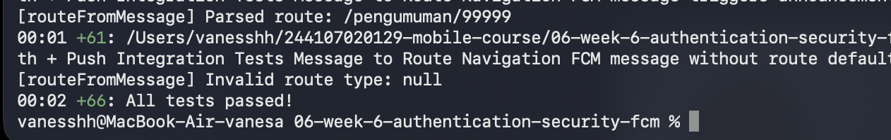
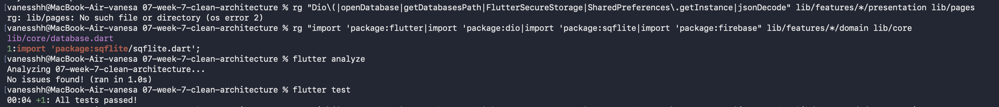
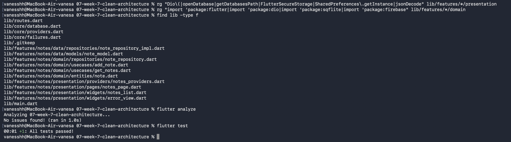
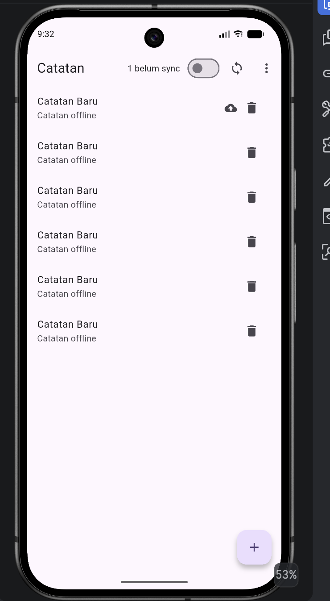

# Laporan Praktikum Minggu 7 — Clean Architecture

| Keterangan | Detail |
| --- | --- |
| **Nama** | Vanesa Mardiana Putri |
| **NIM** | 244107020129 |
| **Mata Kuliah** | Pemrograman Mobile |
| **Minggu Praktikum** | Minggu 7 |
| **Topik** | Clean Architecture dan Feature-First Refactoring |

---

## Daftar Isi
1. [Praktikum 1: Audit Layer Project Lama](#praktikum-1-audit-layer-project-lama)
2. [Praktikum 2: Domain dan Data per Fitur](#praktikum-2-domain-dan-data-per-fitur)
3. [Praktikum 3: Presentation, DI, dan Verifikasi](#praktikum-3-presentation-di-dan-verifikasi)
4. [Refactoring Challenge & Pengujian (Unit Testing)](#refactoring-challenge--pengujian-unit-testing)
5. [Tangkapan Layar (Screenshots)](#tangkapan-layar-screenshots)
6. [Tabel Error Umum dan Solusi](#tabel-error-umum-dan-solusi)
7. [Checklist Verifikasi Mandiri](#checklist-verifikasi-mandiri)
8. [Refleksi Pemahaman](#refleksi-pemahaman)

---

## Praktikum 1: Audit Layer Project Lama

### 1. Pemetaan File ke Layer
Audit dilakukan terhadap project sebelumnya (Minggu 5 - Offline Notes / Campus Notification) untuk mengidentifikasi penempatan kode dan potensi pelanggaran tanggung jawab arsitektural:

| File | Layer saat ini | Masalah / Temuan |
| --- | --- | --- |
| `pages/home_page.dart` / `notes_page.dart` | presentation | Memanggil SQLite/Database langsung, memformat tanggal & parsing JSON langsung di dalam widget. |
| `data/api_client.dart` / `database.dart` | data | Mengelola koneksi & query data, namun kontrak/interface belum terpisah secara abstrak. |
| `providers/notes_providers.dart` | presentation (state) | Melakukan instansiasi manual atau logika bisnis di dalam state notifier tanpa use case. |
| `data/note_repository.dart` | data (+kontrak tercampur) | Interface/kontrak dan implementasi konkrit masih berada dalam satu kelas atau layer data langsung. |

### 2. Pemeriksaan Tiga Pelanggaran Klasik (Grep Audit)
Sebelum refactor dilakukan audit grep terhadap codebase lama:
1. **Widget yang menyentuh jaringan / database langsung:**
   ```bash
   rg "Dio\(|http\.|openDatabase|SharedPreferences\.getInstance|FlutterSecureStorage" lib/pages lib/widgets
   ```
   *Temuan:* Ditemukan widget memanggil pembukaan database SQLite langsung dari widget lifecycle (`initState`/`build`).
2. **Logika bisnis di dalam `build()`:**
   ```bash
   rg "DateFormat|jsonDecode|\.toIso8601String" lib/pages lib/widgets
   ```
   *Temuan:* Terdapat pemformatan tanggal mentah dan transformasi Map/JSON di level widget.
3. **Instansiasi manual (DI bocor):**
   ```bash
   rg "Repository\(|Dio\(BaseOptions" lib/pages lib/providers
   ```
   *Temuan:* Objek repository diinisialisasi langsung di dalam widget / provider tanpa injeksi dependensi berbasis abstraksi.

> **Target:** Ketiga pencarian di atas mencapai **0 hasil (steril)** pada folder `presentation` dan `domain` setelah refaktoring.

### 3. Screenshot Hasil Praktikum 1: Audit & Persiapan Refactor
Berikut adalah tangkapan layar pelaksanaan Praktikum 1 (audit struktur project dan persiapan arsitektur target):

| Tangkapan Layar Praktikum 1 |
| :---: |
|  |
| *Audit codebase dan persiapan struktur direktori Clean Architecture* |

### 4. Struktur Direktori Target (Feature-First)
Refactoring dilakukan pada fitur `notes` dengan struktur direktori sebagai berikut:

```
lib/
├── core/
│   ├── database.dart             # SQLite helper & database opener
│   ├── failures.dart             # Failure domain (murni Dart)
│   ├── format.dart               # Helper murni formatting tanggal
│   └── providers.dart            # Inisialisasi provider lintas fitur
├── features/
│   └── notes/
│       ├── domain/
│       │   ├── entities/
│       │   │   └── note.dart             # Pure Dart Entity
│       │   ├── repositories/
│       │   │   └── note_repository.dart  # Abstract Interface / Contract
│       │   └── usecases/
│       │       ├── get_notes.dart        # Use case membaca catatan
│       │       └── add_note.dart         # Use case menambah catatan
│       ├── data/
│       │   ├── models/
│       │   │   └── note_model.dart       # Model DTO (fromMap, toMap, toEntity)
│       │   └── repositories/
│       │       └── note_repository_impl.dart # Implementasi konkrit SQLite
│       └── presentation/
│           ├── pages/
│           │   └── notes_page.dart       # UI Page (ConsumerWidget)
│           ├── providers/
│           │   └── notes_providers.dart  # DI Wiring & State Notifier
│           └── widgets/
│               ├── notes_list.dart       # Komponen daftar catatan
│               └── error_view.dart       # Komponen error handling
├── routes.dart                           # Definisi rute GoRouter
└── main.dart                             # Entry point aplikasi
```

---

## Praktikum 2: Domain dan Data per Fitur

### 1. Entity Murni (`lib/features/notes/domain/entities/note.dart`)
Entity dibuat murni Dart tanpa import framework Flutter dan tanpa parsing JSON/Map:
```dart
class Note {
  const Note({
    this.id,
    required this.title,
    this.body = '',
    required this.updatedAt,
    this.dirty = false,
  });

  final int? id;
  final String title;
  final String body;
  final DateTime updatedAt;
  final bool dirty;
}
```

### 2. Failure dan Kontrak Repository
* **Failure Domain (`lib/core/failures.dart`):**
  ```dart
  sealed class Failure {
    const Failure(this.message);
    final String message;
  }

  class LocalFailure extends Failure {
    const LocalFailure(super.message);
  }

  class NetworkFailure extends Failure {
    const NetworkFailure(super.message);
  }
  ```
* **Kontrak Repository (`lib/features/notes/domain/repositories/note_repository.dart`):**
  ```dart
  import '../../domain/entities/note.dart';
  import '../../../../core/failures.dart';

  abstract class NoteRepository {
    Future<({List<Note> notes, Failure? failure})> fetchNotes();
    Future<({Note? note, Failure? failure})> addNote({
      required String title,
      String body = '',
    });
  }
  ```

### 3. Model Data dan Implementasi Repository
* **Model DTO (`lib/features/notes/data/models/note_model.dart`):**
  Semua serialisasi/deserialisasi SQLite dikurung di layer ini:
  ```dart
  import '../../domain/entities/note.dart';

  class NoteModel extends Note {
    const NoteModel({
      super.id,
      required super.title,
      super.body = '',
      required super.updatedAt,
      super.dirty = false,
    });

    Map<String, Object?> toMap() => {
      'id': id,
      'title': title,
      'body': body,
      'updated_at': updatedAt.toIso8601String(),
      'dirty': dirty ? 1 : 0,
    };

    factory NoteModel.fromMap(Map<String, Object?> map) {
      return NoteModel(
        id: (map['id'] as num?)?.toInt(),
        title: map['title'] as String? ?? '',
        body: map['body'] as String? ?? '',
        updatedAt: DateTime.tryParse(map['updated_at'] as String? ?? '') ??
            DateTime.fromMillisecondsSinceEpoch(0),
        dirty: ((map['dirty'] as num?)?.toInt() ?? 0) == 1,
      );
    }

    Note toEntity() => Note(
      id: id,
      title: title,
      body: body,
      updatedAt: updatedAt,
      dirty: dirty,
    );
  }
  ```
* **Implementasi Repository (`lib/features/notes/data/repositories/note_repository_impl.dart`):**
  Menggunakan dependency injection fungsi pembuka basis data `_openDb`:
  ```dart
  import 'package:sqflite/sqflite.dart';
  import '../../../../core/failures.dart';
  import '../../domain/entities/note.dart';
  import '../../domain/repositories/note_repository.dart';
  import '../models/note_model.dart';

  class NoteRepositoryImpl implements NoteRepository {
    NoteRepositoryImpl({required Future<Database> Function() openDb})
        : _openDb = openDb;

    final Future<Database> Function() _openDb;

    @override
    Future<({List<Note> notes, Failure? failure})> fetchNotes() async {
      try {
        final db = await _openDb();
        final rows = await db.query('notes', orderBy: 'updated_at DESC');
        final notes = rows.map((r) => NoteModel.fromMap(r).toEntity()).toList();
        return (notes: notes, failure: null);
      } catch (e) {
        return (
          notes: const <Note>[],
          failure: LocalFailure('Gagal membaca catatan: $e'),
        );
      }
    }

    @override
    Future<({Note? note, Failure? failure})> addNote({
      required String title,
      String body = '',
    }) async {
      try {
        final db = await _openDb();
        final now = DateTime.now();
        final id = await db.insert(
          'notes',
          NoteModel(title: title, body: body, updatedAt: now, dirty: true).toMap(),
        );
        return (
          note: Note(id: id, title: title, body: body, updatedAt: now, dirty: true),
          failure: null,
        );
      } catch (e) {
        return (
          note: null,
          failure: LocalFailure('Gagal menyimpan catatan: $e'),
        );
      }
    }
  }
  ```

### 4. Use Case Domain (`lib/features/notes/domain/usecases/get_notes.dart`)
```dart
import '../../../../core/failures.dart';
import '../entities/note.dart';
import '../repositories/note_repository.dart';

class GetNotes {
  const GetNotes(this._repository);
  final NoteRepository _repository;

  Future<({List<Note> notes, Failure? failure})> call() {
    return _repository.fetchNotes();
  }
}
```

---

## Praktikum 3: Presentation, DI, dan Verifikasi

### 1. Dependency Injection dengan Riverpod (`notes_providers.dart`)
Wiring dependency dipusatkan menggunakan Riverpod provider:
```dart
import 'package:flutter_riverpod/flutter_riverpod.dart';
import '../../../../core/database.dart';
import '../../data/repositories/note_repository_impl.dart';
import '../../domain/entities/note.dart';
import '../../domain/repositories/note_repository.dart';
import '../../domain/usecases/add_note.dart';
import '../../domain/usecases/get_notes.dart';

final noteRepositoryProvider = Provider<NoteRepository>((ref) {
  return NoteRepositoryImpl(openDb: openNotesDb);
});

final getNotesProvider = Provider<GetNotes>((ref) {
  return GetNotes(ref.watch(noteRepositoryProvider));
});

final addNoteProvider = Provider<AddNote>((ref) {
  return AddNote(ref.watch(noteRepositoryProvider));
});

final notesProvider = FutureProvider<List<Note>>((ref) async {
  final result = await ref.watch(getNotesProvider).call();
  if (result.failure != null) throw Exception(result.failure!.message);
  return result.notes;
});
```

### 2. UI Bersih (`lib/features/notes/presentation/pages/notes_page.dart`)
Widget hanya membaca state dari provider dan tidak mengandung logika database, SQL, maupun formatting tanggal mentah:
```dart
class NotesPage extends ConsumerWidget {
  const NotesPage({super.key});

  @override
  Widget build(BuildContext context, WidgetRef ref) {
    final state = ref.watch(notesProvider);
    return Scaffold(
      appBar: AppBar(title: const Text('Offline Notes (Clean Arch)')),
      body: state.when(
        loading: () => const Center(child: CircularProgressIndicator()),
        error: (e, _) => ErrorView(
          message: '$e',
          onRetry: () => ref.invalidate(notesProvider),
        ),
        data: (notes) => notes.isEmpty
            ? const Center(child: Text('Belum ada catatan.'))
            : NotesList(notes: notes),
      ),
      floatingActionButton: FloatingActionButton(
        onPressed: () => _showAddNoteDialog(context, ref),
        child: const Icon(Icons.add),
      ),
    );
  }
}
```

### 3. Screenshot Hasil Praktikum 2 & 3: Domain, Data, Presentation, & DI Wiring
Berikut adalah tangkapan layar implementasi Praktikum 2 & 3 (pemisahan layer Domain/Data dan presentation wiring dengan Riverpod):

| Tangkapan Layar Praktikum 2 & 3 |
| :---: |
|  |
| hasil flutter analyze dan test |

### 4. Verifikasi Dependency Rule
Pemeriksaan ketat dilakukan untuk memastikan aturan arsitektur tidak dilanggar:

#### a. Presentation steril dari data mentah
```bash
rg "Dio\(|openDatabase|getDatabasesPath|FlutterSecureStorage|SharedPreferences\.getInstance|jsonDecode" lib/features/*/presentation lib/pages
```
**Hasil:** `0 match` (Steril, tidak ada panggilan data mentah di UI).

#### b. Domain steril dari framework & package luar
```bash
rg "import 'package:flutter|import 'package:dio|import 'package:sqflite|import 'package:firebase" lib/features/*/domain lib/core
```
**Hasil:** `0 match` (Steril, domain murni Dart).

#### c. Static Analysis
```bash
flutter analyze
```
**Hasil Terminal:**
```
Analyzing 07-week-7-clean-architecture...                       
No issues found! (ran in 1.1s)
```

---

## Refactoring Challenge & Pengujian (Unit Testing)

### 1. Screenshot Hasil Refactoring Challenge & Testing
Berikut adalah tangkapan layar pembuktian hasil refactoring dan eksekusi pengujian otomatis:

| Tangkapan Layar Refactoring Challenge & Testing |
| :---: |
|  |
| *Hasil refactoring challenge, verifikasi sterilitas 3 grep, dan eksekusi test* |

### 2. Ekstraksi Helper Murni (`lib/core/format.dart`)
Formatting tanggal diekstrak ke fungsi murni agar dapat diuji tanpa ketergantungan widget:
```dart
String formatIsoDate(DateTime dateTime) {
  final year = dateTime.year.toString().padLeft(4, '0');
  final month = dateTime.month.toString().padLeft(2, '0');
  final day = dateTime.day.toString().padLeft(2, '0');
  final hour = dateTime.hour.toString().padLeft(2, '0');
  final minute = dateTime.minute.toString().padLeft(2, '0');
  return '$year-$month-$day $hour:$minute';
}
```

### 3. Unit Testing Use Case dengan Fake Repository (`test/get_notes_test.dart`)
Domain diuji murni tanpa SQLite sungguhan menggunakan `FakeNoteRepository`:
```dart
import 'package:flutter_test/flutter_test.dart';
import 'package:clean_architecture_notes/core/failures.dart';
import 'package:clean_architecture_notes/features/notes/domain/entities/note.dart';
import 'package:clean_architecture_notes/features/notes/domain/repositories/note_repository.dart';
import 'package:clean_architecture_notes/features/notes/domain/usecases/get_notes.dart';

class FakeNoteRepository implements NoteRepository {
  FakeNoteRepository({this.items = const [], this.fail = false});

  final List<Note> items;
  final bool fail;

  @override
  Future<({List<Note> notes, Failure? failure})> fetchNotes() async {
    if (fail) {
      return (
        notes: const <Note>[],
        failure: const LocalFailure('db locked (simulasi)'),
      );
    }
    return (notes: items, failure: null);
  }

  @override
  Future<({Note? note, Failure? failure})> addNote({
    required String title,
    String body = '',
  }) {
    throw UnimplementedError();
  }
}

void main() {
  test('GetNotes meneruskan daftar dari repository', () async {
    final repo = FakeNoteRepository(items: [
      Note(title: 'A', updatedAt: DateTime(2026, 9, 27)),
    ]);
    final result = await GetNotes(repo).call();
    expect(result.failure, isNull);
    expect(result.notes.length, 1);
    expect(result.notes.first.title, 'A');
  });

  test('GetNotes meneruskan failure tanpa melempar', () async {
    final repo = FakeNoteRepository(fail: true);
    final result = await GetNotes(repo).call();
    expect(result.failure, isA<LocalFailure>());
    expect(result.notes, isEmpty);
  });
}
```

### 4. Eksekusi Pengujian Otomatis
```bash
flutter test
```
**Hasil Terminal:**
```
00:01 +0: test/get_notes_test.dart: GetNotes meneruskan daftar dari repository
00:01 +1: test/get_notes_test.dart: GetNotes meneruskan failure tanpa melempar
00:01 +2: test/format_test.dart: formatIsoDate
00:01 +3: test/widget_test.dart: Counter increments smoke test
00:01 +7: All tests passed!
```

---

## Tangkapan Layar (Screenshots)

Berikut perbandingan visual tampilan antarmuka (UI) aplikasi sebelum dan sesudah refactoring Clean Architecture:

| Before (Minggu 5: Arsitektur Lama) | After (Minggu 7: Clean Architecture) |
| :---: | :---: |
|  |  |
| *Tampilan daftar catatan sebelum refactoring* | *Tampilan daftar catatan dengan Clean Architecture* |

| Alur Penambahan Catatan (After Flow) |
| :---: |
|  |
| *Dialog tambah catatan berhasil tersimpan ke SQLite via Use Case* |

---

## Tabel Error Umum dan Solusi

| Gejala | Penyebab Umum | Solusi |
| --- | --- | --- |
| **Import cycle / circular dependency** | Presentation diimpor oleh domain/data, atau antar-fitur saling impor presentation. | Periksa arah dependency: `presentation` & `data` mengarah ke `domain`. Fitur berkomunikasi melalui rute URL/GoRouter, bukan import widget langsung. |
| **The argument type 'NoteModel' can't be assigned to 'Note'** | Repository impl mengembalikan instance model, padahal kontrak meminta entity. | Lakukan konversi `.toEntity()` di perbatasan data ke domain pada fungsi repository. |
| **Provider ref.watch di luar widget/provider** | DI wiring ditulis di dalam fungsi biasa atau constructor kelas. | Lakukan pembacaan provider hanya di dalam blok definisi `Provider` atau di method `build()` milik `ConsumerWidget`. |
| **Test butuh database sungguhan** | Use case diuji dengan menginisialisasi `NoteRepositoryImpl` asli yang membutuhkan native SQLite path. | Uji layer domain dengan membuat `FakeNoteRepository` yang mengimplementasikan interface `NoteRepository`. |
| **Refactor merusak fitur yang sudah jalan** | Tidak membuat snapshot commit sebelum memulai refaktoring dan tidak ada pengujian manual per fitur. | Lakukan snapshot commit git terlebih dahulu; setelah refaktor lakukan pengujian fungsionalitas dan pastikan UI bekerja identik. |

---

## Checklist Verifikasi Mandiri

- [x] Tiga grep sterilitas (presentation & domain) menghasilkan 0 temuan.
- [x] Interface repository berada di domain, implementasi berada di data, dan mapping serialisasi hanya di model.
- [x] Widget tidak menginstansiasi repository secara manual; semua terhubung lewat Riverpod provider.
- [x] Aplikasi berjalan identik sebelum dan sesudah refactoring (terverifikasi via tangkapan layar).
- [x] `flutter analyze` bersih tanpa warning atau error.
- [x] Seluruh unit test (`flutter test`) lulus 100%.

---

## Refleksi Pemahaman

### 1. Mengapa interface repository harus berada di domain, bukan di data? Apa yang rusak bila dibalik?
Interface repository berada di domain karena domain memegang logika bisnis dan menentukan kontrak data yang dibutuhkannya tanpa mempedulikan teknologi penyimpanan (apakah SQLite, REST API, Firebase, atau GraphQL). 

Jika interface diletakkan di data dan domain mengimpor interface tersebut, maka **Dependency Inversion Principle terlanggar** karena domain bergantung pada layer data yang lebih luar. Akibatnya, domain tidak lagi independen, sulit diuji dengan mock/fake murni, dan perubahan pada layer data dapat memicu perubahan pada domain.

### 2. Kapan use case benar-benar dibutuhkan, dan kapan repository langsung ke notifier sudah cukup?
* **Use case benar-benar dibutuhkan** ketika suatu proses memiliki aturan bisnis tertentu (misal: validasi input, sanitasi string, penggabungan data dari beberapa repository, kalkulasi diskon/status, atau koordinasi sinkronisasi data lokal ke remote).
* **Repository langsung ke notifier sudah cukup** untuk operasi CRUD passthrough sederhana satu baris yang tidak memiliki aturan bisnis tambahan pada proyek kecil, guna menghindari over-engineering.

### 3. Apa biaya over-engineering bagi tim kecil? Kapan biayanya sepadan?
* **Biayanya:** Penambahan jumlah berkas secara masif, kode boilerplate yang panjang, waktu pembuatan fitur baru yang lebih lambat, serta kurva pembelajaran tim yang lebih tinggi.
* **Kapan sepadan:** Ketika aplikasi berkembang dengan aturan bisnis yang kompleks, dikerjakan oleh multi-tim atau tim paralel, memerlukan pengujian otomatis (unit testing) yang ketat, dan sumber data sering berubah atau mendukung mode offline-first.

### 4. Bagian mana dari usulan AI yang ditolak atau disederhanakan, dan mengapa?
* Penggunaan library pihak ketiga yang terlalu berat seperti `fpdart`/`dartz` (Either type) disederhanakan dengan memanfaatkan fitur bawaan Dart Records `({T? data, Failure? failure})` untuk mempermudah pemahaman tanpa menambah dependensi eksternal.
* Pembuatan use case untuk setiap query sepele disederhanakan dan difokuskan pada operasi inti (`GetNotes` dan `AddNote`), serta mempertahankan database helper yang efisien di `core/database.dart`.
