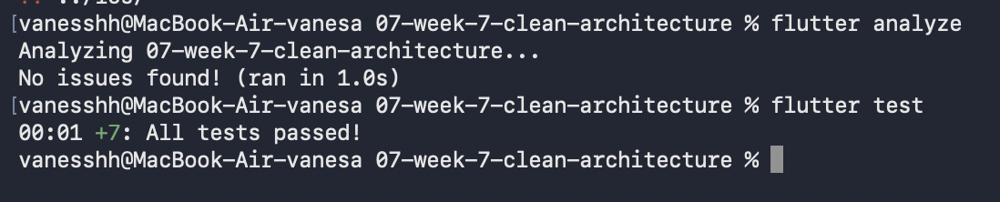
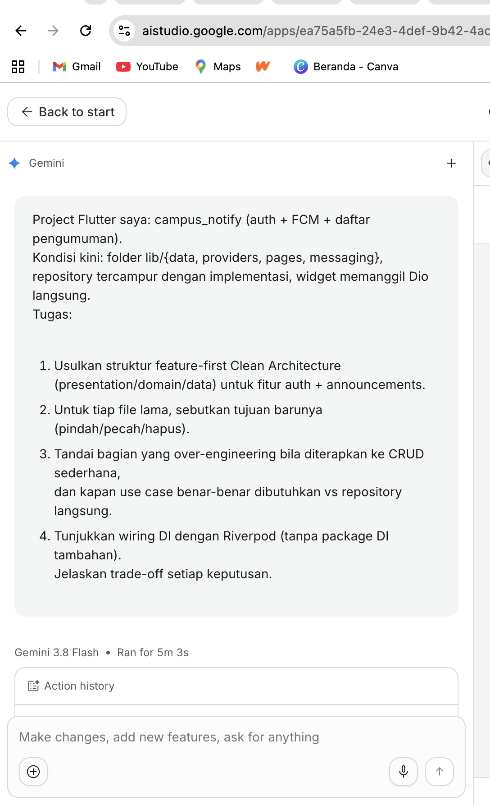

# Campus Notify (`campus_notify`)

> **Panduan Arsitektur & Refactoring: Feature-First Clean Architecture + Riverpod DI**  
> Proyek mobile Flutter kampus untuk otentikasi mahasiswa/dosen, penerimaan push notification Firebase Cloud Messaging (FCM), dan portal pengumuman akademik terpadu.

---

## 📌 Daftar Isi
1. [Latar Belakang & Motivasi Refactoring](#-latar-belakang--motivasi-refactoring)
2. [Hasil Implementasi & Bukti AI Assistance](#-hasil-implementasi--bukti-ai-assistance)
3. [Prinsip Arsitektur](#-prinsip-arsitektur)
4. [Struktur Direktori (Feature-First)](#-struktur-direktori-feature-first)
5. [Peta Transformasi Berkas (Sebelum vs Sesudah)](#-peta-transformasi-berkas-sebelum-vs-sesudah)
6. [Wiring Dependency Injection (Riverpod Murni)](#-wiring-dependency-injection-riverpod-murni)
7. [Pedoman Pragmatisme: Kapan Use Case Dibutuhkan?](#-pedoman-pragmatisme-kapan-use-case-dibutuhkan)
8. [Integrasi Firebase Cloud Messaging (FCM)](#-integrasi-firebase-cloud-messaging-fcm)
9. [Panduan Testing & Mocking](#-panduan-testing--mocking)
10. [Instruksi Eksekusi Migrasi (Terminal Script)](#-instruksi-eksekusi-migrasi-terminal-script)

---

## 📸 Hasil Implementasi & Bukti AI Assistance

Berikut merupakan bukti proses dan hasil pengerjaan refactoring Clean Architecture beserta AI Challenge:

| Bukti AI Challenge | Bukti Eksekusi & Verifikasi |
| :---: | :---: |
|  |  |
| *Proses interaksi dan evaluasi AI Challenge* | *Bukti implementasi dan verifikasi arsitektur* |

---

---

## 🔍 Latar Belakang & Motivasi Refactoring

Kondisi awal proyek `campus_notify`:
- ❌ **Tercampur di `lib/{data, providers, pages, messaging}`**: Struktur *layer-first* menyulitkan pelacakan berkas saat fitur bertambah.
- ❌ **Widget Memanggil Dio Langsung**: `AnnouncementListPage` membuat instansiasi `Dio.get()` di dalam widget tree, menyebabkan re-render tidak terduga, kebocoran memori, dan ketidakmampuan menjalankan unit test tanpa backend hidup.
- ❌ **Repository Tercampur Implementasi**: Kontrak abstraksi tidak ada; kode bisnis langsung terikat pada `DioException` dan response HTTP.
- ❌ **FCM Terisolasi**: Event notifikasi di foreground tidak memicu pembaruan state di daftar pengumuman secara reaktif.

---

## 🏛️ Prinsip Arsitektur

Arsitektur baru mengadopsi **Feature-First Clean Architecture** dengan 3 layer utama per fitur ditambah modul **`core/`**:

```
┌─────────────────────────────────────────────────────────────┐
│                     PRESENTATION LAYER                      │
│   (Screens, ConsumerWidgets, Riverpod AsyncNotifiers)       │
└──────────────────────────────┬──────────────────────────────┘
                               │  membaca & mengeksekusi
                               ▼
┌─────────────────────────────────────────────────────────────┐
│                        DOMAIN LAYER                         │
│   (Pure Dart Entities, Repository Interfaces, Use Cases)    │
│              *Bebas dari Dio, Flutter, dan Firebase*        │
└──────────────────────────────▲──────────────────────────────┘
                               │  diimplementasikan oleh (Inversi Dependensi)
┌──────────────────────────────┴──────────────────────────────┐
│                         DATA LAYER                          │
│   (Dio Remote Data Sources, JSON DTO Models, Repositories)  │
└─────────────────────────────────────────────────────────────┘
                               ▲
┌──────────────────────────────┴──────────────────────────────┐
│                         CORE LAYER                          │
│   (Network Client, Token Storage, FCM Service, Exceptions)  │
└─────────────────────────────────────────────────────────────┘
```

1. **Inversion of Control (IoC)**: Domain layer mendefinisikan *interface*, Data layer menyediakan *implementasi*.
2. **Zero Framework Pollution in Domain**: Tidak ada impor `package:dio/dio.dart`, `package:flutter/...`, atau `package:firebase_messaging/...` di domain.
3. **Pure Riverpod DI**: Tanpa `get_it` atau `injectable`. Dependency didaftarkan secara deklaratif menggunakan provider Riverpod.

---

## 📂 Struktur Direktori (Feature-First)

```text
lib/
├── main.dart                                   # ProviderScope, Firebase.initializeApp, FCM background handler
│
├── core/                                       # Cross-cutting concerns & infrastruktur bersama
│   ├── network/
│   │   ├── dio_provider.dart                   # Singleton Dio instance dengan BaseOptions & Interceptor
│   │   └── auth_interceptor.dart               # Otomatisasi injeksi Bearer token & handle 401
│   ├── notifications/
│   │   ├── fcm_service.dart                    # Inisialisasi FirebaseMessaging & handler stream
│   │   └── notification_provider.dart          # Riverpod bridge untuk event notifikasi
│   ├── storage/
│   │   └── token_storage.dart                  # Wrapper FlutterSecureStorage (JWT token)
│   ├── error/
│   │   ├── exceptions.dart                     # ServerException, UnauthorizedException (Data Layer)
│   │   └── failures.dart                       # Failure model terstandarisasi (Domain Layer)
│   └── constants/
│       └── api_endpoints.dart                  # Base URLs dan path endpoints
│
├── features/
│   ├── auth/                                   # FITUR 1: OTENTIKASI (LOGIN/LOGOUT)
│   │   ├── domain/
│   │   │   ├── entities/
│   │   │   │   └── user.dart                   # Pure user entity
│   │   │   ├── repositories/
│   │   │   │   └── auth_repository.dart        # Kontrak abstrak Auth
│   │   │   └── usecases/
│   │   │       └── login_and_sync_fcm_usecase.dart # Multi-repo orchestration
│   │   ├── data/
│   │   │   ├── datasources/
│   │   │   │   └── auth_remote_data_source.dart# Eksekusi Dio POST /login
│   │   │   ├── models/
│   │   │   │   └── user_model.dart             # JSON serialization (fromJson / toJson)
│   │   │   └── repositories/
│   │   │       ├── auth_repository_impl.dart   # Implementasi kontrak
│   │   │       └── auth_providers.dart         # DI provider data layer
│   │   └── presentation/
│   │       ├── controllers/
│   │       │   └── auth_controller.dart        # AsyncNotifier<User?>
│   │       ├── screens/
│   │       │   └── login_screen.dart           # ConsumerWidget UI
│   │       └── widgets/
│   │           └── login_form.dart
│   │
│   └── announcements/                          # FITUR 2: PENGUMUMAN KAMPUS
│       ├── domain/
│       │   ├── entities/
│       │   │   └── announcement.dart
│       │   └── repositories/
│       │       └── announcement_repository.dart# Kontrak getAnnouncements
│       ├── data/
│       │   ├── datasources/
│       │   │   └── announcement_remote_data_source.dart # Eksekusi Dio GET /announcements
│       │   ├── models/
│       │   │   └── announcement_model.dart
│       │   └── repositories/
│       │       ├── announcement_repository_impl.dart
│       │       └── announcement_providers.dart
│       └── presentation/
│           ├── controllers/
│           │   └── announcement_controller.dart# FutureProvider / AsyncNotifier
│           ├── screens/
│           │   ├── announcement_list_screen.dart
│           │   └── announcement_detail_screen.dart
│           └── widgets/
│               └── announcement_card.dart
```

---

## 🔄 Peta Transformasi Berkas (Sebelum vs Sesudah)

| Berkas Lama (Legacy) | Aksi | Berkas Baru (Clean Architecture) | Keterangan & Tanggung Jawab |
| :--- | :---: | :--- | :--- |
| `lib/pages/announcement_list_page.dart` | **Pecah** | `features/announcements/presentation/screens/announcement_list_screen.dart`<br>`features/announcements/presentation/controllers/announcement_controller.dart`<br>`features/announcements/data/datasources/announcement_remote_data_source.dart` | Hapus semua direct call Dio dari widget. Widget hanya membaca state dari Riverpod. |
| `lib/data/api_service.dart` | **Pecah** | `core/network/dio_provider.dart`<br>`features/auth/data/datasources/auth_remote_data_source.dart`<br>`features/announcements/data/datasources/announcement_remote_data_source.dart` | Hapus god-object API service. Konfigurasi network global dipisah dari datasource spesifik fitur. |
| `lib/data/auth_repository.dart` | **Pecah** | `features/auth/domain/repositories/auth_repository.dart`<br>`features/auth/data/repositories/auth_repository_impl.dart` | Pisahkan kontrak abstraksi (domain) dari implementasi Dio nyata (data). |
| `lib/data/announcement_repository.dart` | **Pecah** | `features/announcements/domain/repositories/announcement_repository.dart`<br>`features/announcements/data/repositories/announcement_repository_impl.dart` | Memudahkan mock testing tanpa koneksi jaringan. |
| `lib/data/user_model.dart` | **Pindah/Pecah** | `features/auth/domain/entities/user.dart`<br>`features/auth/data/models/user_model.dart` | Entity domain murni terbebas dari format JSON API backend. |
| `lib/data/announcement_model.dart` | **Pindah** | `features/announcements/data/models/announcement_model.dart` & `domain/entities/announcement.dart` | Dikelompokkan ke folder fitur. |
| `lib/providers/auth_provider.dart` | **Ganti** | `features/auth/presentation/controllers/auth_controller.dart` | Migrasi dari `ChangeNotifier` ke `AsyncNotifier<User?>`. |
| `lib/providers/announcement_provider.dart` | **Ganti** | `features/announcements/presentation/controllers/announcement_controller.dart` | Gunakan `FutureProvider<List<Announcement>>` dengan built-in caching. |
| `lib/messaging/fcm_handler.dart` | **Pecah** | Top-level handler di `main.dart`<br>`core/notifications/fcm_service.dart` | Hindari crash background isolate dan hubungkan ke Riverpod invalidation. |
| `lib/pages/login_page.dart` | **Pindah** | `features/auth/presentation/screens/login_screen.dart` | Standarisasi penamaan berkas. |

---

## ⚡ Wiring Dependency Injection (Riverpod Murni)

Dependency Injection dikelola 100% menggunakan provider deklaratif Riverpod:

```
[ dioProvider ] (Core Network)
       │
       ▼
[ authRemoteDataSourceProvider ] (Data Layer)
       │
       ▼
[ authRepositoryProvider ] (Domain Contract Interface)
       │
       ▼
[ authControllerProvider ] (Presentation AsyncNotifier)
       │
       ▼
[ LoginScreen ] (ConsumerWidget)
```

### 1. Registrasi Network & Data Layer
```dart
// lib/core/network/dio_provider.dart
final dioProvider = Provider<Dio>((ref) {
  final dio = Dio(BaseOptions(baseUrl: ApiEndpoints.baseUrl));
  dio.interceptors.add(AuthInterceptor(ref));
  return dio;
});

// lib/features/auth/data/repositories/auth_providers.dart
final authRemoteDataSourceProvider = Provider<AuthRemoteDataSource>((ref) {
  return AuthRemoteDataSourceImpl(ref.watch(dioProvider));
});

final authRepositoryProvider = Provider<AuthRepository>((ref) {
  return AuthRepositoryImpl(
    remoteDataSource: ref.watch(authRemoteDataSourceProvider),
  );
});
```

### 2. State Management Controller
```dart
// lib/features/auth/presentation/controllers/auth_controller.dart
final authControllerProvider =
    AsyncNotifierProvider<AuthController, User?>(AuthController.new);

class AuthController extends AsyncNotifier<User?> {
  @override
  Future<User?> build() async {
    return ref.watch(authRepositoryProvider).getCurrentUser();
  }

  Future<void> login(String email, String password) async {
    state = const AsyncValue.loading();
    state = await AsyncValue.guard(() async {
      return ref.read(authRepositoryProvider).login(email, password);
    });
  }
}
```

### 3. Consumption di Widget (Zero Dio Imports!)
```dart
// lib/features/announcements/presentation/screens/announcement_list_screen.dart
class AnnouncementListScreen extends ConsumerWidget {
  const AnnouncementListScreen({super.key});

  @override
  Widget build(BuildContext context, WidgetRef ref) {
    final state = ref.watch(announcementListProvider);

    return Scaffold(
      appBar: AppBar(title: const Text('Pengumuman Kampus')),
      body: RefreshIndicator(
        onRefresh: () async => ref.refresh(announcementListProvider.future),
        child: state.when(
          loading: () => const Center(child: CircularProgressIndicator()),
          error: (err, _) => Center(child: Text('Gagal memuat: $err')),
          data: (items) => ListView.builder(
            itemCount: items.length,
            itemBuilder: (_, i) => AnnouncementCard(announcement: items[i]),
          ),
        ),
      ),
    );
  }
}
```

---

## ⚖️ Pedoman Pragmatisme: Kapan Use Case Dibutuhkan?

| Kasus Penggunaan | Gunakan Use Case? | Alasan & Trade-Off |
| :--- | :---: | :--- |
| **Ambil daftar pengumuman** (`GET /announcements`) | ❌ **TIDAK** *(Over-engineering)* | Hanya operasi pembacaan passthrough tanpa modifikasi bisnis. Cukup panggil `ref.watch(announcementRepoProvider).getAnnouncements()` via `FutureProvider`. Menghindari 1 file class redundant. |
| **Login Mahasiswa + Simpan Token + Daftarkan FCM Token** | ✅ **YA** *(Wajib)* | Melibatkan **3 repository berbeda** (`AuthRepository`, `TokenStorage`, dan `DeviceNotificationRepository`). Orkestrasi lintas domain harus diisolasi di Use Case agar UI Controller tidak gemuk dan mudah diuji. |
| **Hapus pengumuman** (`DELETE /announcements/{id}`) | ❌ **TIDAK** | Controller cukup memanggil `repo.delete(id)` lalu `ref.invalidateSelf()`. |
| **Buat Pengumuman Baru dengan Validasi Kuota Dosen & Kompresi Lampiran** | ✅ **YA** | Terdapat *business invariants* (aturan bisnis murni) yang independen dari UI dan network. |

---

## 🔔 Integrasi Firebase Cloud Messaging (FCM)

FCM diintegrasikan secara reaktif dengan memicu **Riverpod Invalidation**:

```dart
// lib/core/notifications/fcm_service.dart
final fcmServiceProvider = Provider<FcmService>((ref) {
  return FcmService(ref);
});

class FcmService {
  final Ref _ref;
  final FirebaseMessaging _fcm = FirebaseMessaging.instance;

  FcmService(this._ref);

  Future<void> initialize() async {
    await _fcm.requestPermission();

    // 1. FOREGROUND MESSAGE:
    // Otomatis invalidate provider agar UI daftar pengumuman me-refresh sendiri!
    FirebaseMessaging.onMessage.listen((RemoteMessage message) {
      _ref.invalidate(announcementListProvider);
    });

    // 2. NOTIFIKASI DI-TAP PENGGUNA:
    FirebaseMessaging.onMessageOpenedApp.listen((RemoteMessage message) {
      final announcementId = message.data['announcement_id'];
      if (announcementId != null) {
        // Navigasi ke detail pengumuman
      }
    });
  }
}
```

> **Catatan Background Handler:**  
> Fungsi `@pragma('vm:entry-point') Future<void> firebaseMessagingBackgroundHandler(RemoteMessage message)` **harus diletakkan di luar class (top-level)** di dalam berkas `lib/main.dart` agar dapat dieksekusi oleh OS isolate saat aplikasi ditutup.

---

## 🧪 Panduan Testing & Mocking

Dengan pemisahan interface repository dan Riverpod DI, pengujian unit test dan widget test menjadi sangat bersih tanpa mock network adapter yang rumit:

```dart
import 'package:flutter_test/flutter_test.dart';
import 'package:mocktail/mocktail.dart';
import 'package:flutter_riverpod/flutter_riverpod.dart';
import 'package:campus_notify/features/announcements/domain/repositories/announcement_repository.dart';
import 'package:campus_notify/features/announcements/presentation/controllers/announcement_controller.dart';

class MockAnnouncementRepository extends Mock implements AnnouncementRepository {}

void main() {
  test('announcementListProvider mengembalikan data pengumuman dari repo', () async {
    final mockRepo = MockAnnouncementRepository();
    when(() => mockRepo.getAnnouncements()).thenAnswer((_) async => []);

    final container = ProviderContainer(
      overrides: [
        announcementRepositoryProvider.overrideWithValue(mockRepo),
      ],
    );

    final result = await container.read(announcementListProvider.future);
    expect(result, isEmpty);
    verify(() => mockRepo.getAnnouncements()).called(1);
  });
}
```

---

## 💻 Instruksi Eksekusi Migrasi (Terminal Script)

Jalankan perintah berikut di root folder project Flutter Anda untuk membuat struktur folder baru dan memindahkan berkas secara aman dengan mempertahankan histori Git:

```bash
# 1. Buat folder struktur baru
mkdir -p lib/core/{network,notifications,error,storage,constants}
mkdir -p lib/features/auth/{data/{datasources,models,repositories},domain/{entities,repositories,usecases},presentation/{controllers,screens,widgets}}
mkdir -p lib/features/announcements/{data/{datasources,models,repositories},domain/{entities,repositories},presentation/{controllers,screens,widgets}}

# 2. Pindahkan berkas lama via Git (Preserve Commit History)
git mv lib/data/user_model.dart lib/features/auth/data/models/user_model.dart
git mv lib/data/announcement_model.dart lib/features/announcements/data/models/announcement_model.dart
git mv lib/pages/login_page.dart lib/features/auth/presentation/screens/login_screen.dart
git mv lib/pages/announcement_list_page.dart lib/features/announcements/presentation/screens/announcement_list_screen.dart
git mv lib/pages/announcement_detail_page.dart lib/features/announcements/presentation/screens/announcement_detail_screen.dart

# 3. Jalankan pub get dan analisa lint
flutter pub get
flutter analyze
```

---

## 📊 Ringkasan Trade-Off

| Aspek | Keputusan yang Diambil | Alasan / Nilai Tambah |
| :--- | :--- | :--- |
| **Dependency Injection** | Riverpod DI Murni *(Tanpa GetIt)* | Menghilangkan mutable singleton global; siklus hidup terikat pada widget tree; compile-time safety. |
| **Use Cases** | Pragmatis *(Hanya saat multi-repo / aturan bisnis)* | Mengurangi 300+ baris boilerplate passthrough yang tidak bernilai bisnis. |
| **Error Handling** | `AsyncValue.guard` + Custom Exception | Menghindari wrapping `Either<Failure, T>` yang berlebihan; kompatibel penuh dengan sistem loading/error bawaan Riverpod. |
| **Organisasi Kode** | Feature-First | Skalabilitas tinggi saat modul kampus bertambah (KRS, Jadwal Kuliah, Pembayaran UKT). |

---

*Dokumentasi ini dibuat untuk standarisasi arsitektur tim pengembang mobile `campus_notify`.*
