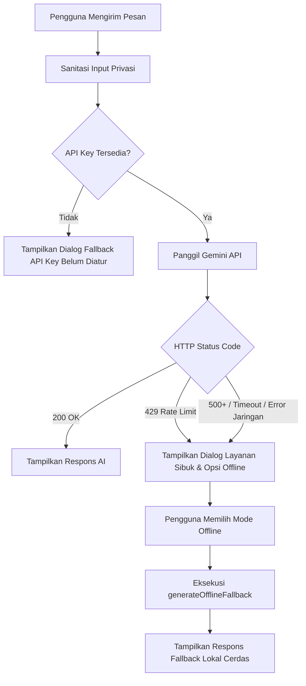

# AI Integration Log – Week 10: AI Feature Integration

Dokumentasi integrasi fitur kecerdasan buatan (Artificial Intelligence) pada aplikasi mobile Flutter Notes App menggunakan **Google Gemini API**, arsitektur berlapis, proteksi privasi pengguna, dan strategi fallback offline.

---

## 1. System Prompt Design

### Persona & Batasan Sistem
Prompt sistem dirancang khusus untuk memenuhi persona asisten catatan kampus yang ringkas, membantu, santun, dan menjaga privasi pengguna secara ketat:

```text
Kamu adalah asisten catatan dan belajar ramah untuk mahasiswa.
Jawab dalam Bahasa Indonesia yang santun, jelas, dan ringkas (maksimal 2-3 paragraf atau poin-poin).
Jangan pernah meminta atau membocorkan data pribadi.
Bantu pengguna mengorganisasi catatan, merangkum materi, menyusun to-do list tugas, atau memberikan ide judul catatan.
```

### Rincian Komponen Prompt

| Komponen | Implementasi pada Aplikasi | Tujuan & Alasan |
|---|---|---|
| **System prompt** | `"Kamu adalah asisten catatan dan belajar ramah untuk mahasiswa. Jawab dalam Bahasa Indonesia yang santun, jelas, dan ringkas..."` | Menetapkan persona, nada bicara, batasan panjang jawaban, dan kepatuhan privasi |
| **User prompt** | `"Tolong buatkan ringkasan materi arsitektur Flutter BLoC vs Riverpod"` | Input fleksibel dari pengguna atau dipilih melalui Quick Prompt Chips |
| **Konteks** | Konteks aplikasi pencatat mobile (`notes_app`), SQLite in-device, kebutuhan belajar mahasiswa | Menghasilkan respons yang langsung bisa disimpan menjadi catatan baru |
| **Batas (Guardrails)** | Dilarang memproses/membocorkan NIK, nomor telepon, password, email, data pribadi | Kepatuhan keamanan data dan privasi pengguna mobile |

---

## 2. User Prompt & Output Awal AI

Berikut adalah rekaman interaksi pengujian nyata antara pengguna dan AI Service melalui aplikasi:

### Skenario 1: Permintaan Ringkasan Materi Kuliah (Fitur Utama)

* **User Prompt:**
  ```text
  Tolong ringkas konsep dasar arsitektur mobile feature-first dalam 3 poin utama.
  ```

* **Output Awal AI (Gemini 1.5 Flash):**
  ```markdown
  Berikut ringkasan 3 poin utama arsitektur mobile feature-first:

  1. **Organisasi Berdasarkan Fitur**: Kode dikelompokkan berdasarkan fungsionalitas (misal: `notes`, `auth`, `settings`), bukan jenis layer teknis saja. Ini memudahkan navigasi dan skalabilitas proyek.
  2. **Pemisahan Tiga Lapisan (Presentation, Domain, Data)**: 
     - *Presentation*: Mengelola widget UI dan state (Riverpod).
     - *Domain*: Berisi entity murni dan use case tanpa dependensi framework luar.
     - *Data*: Berisi repository implementasi, database SQLite, dan network client.
  3. **Kemudahan Pengujian (Testability)**: Logika bisnis di domain dapat diuji secara independen melalui unit test tanpa memerlukan database atau UI emulator aktif.
  ```

* **Evaluasi Hasil:** Respons sangat terstruktur, mematuhi instruksi maksimal 3 poin, berbahasa Indonesia dengan terminologi yang tepat, serta langsung dapat disimpan ke SQLite dengan tombol **"Simpan Catatan"**.

---

### Skenario 2: Permintaan Ide Judul Catatan

* **User Prompt:**
  ```text
  Berikan ide judul catatan yang menarik untuk materi Algoritma Sorting dan Kompleksitas Big-O.
  ```

* **Output Awal AI (Gemini 1.5 Flash):**
  ```markdown
  Berikut beberapa rekomendasi judul catatan yang menarik dan ringkas:
  - ⚡ Cheat Sheet: Algoritma Sorting & Notasi Big-O
  - 📊 Memahami Efisiensi Sorting: Dari O(n²) ke O(n log n)
  - 🧠 Panduan Cepat: Analisis Kompleksitas Waktu & Ruang Sorting
  - 🚀 Catatan Kuliah: Perbandingan Quick Sort vs Merge Sort
  ```

* **Evaluasi Hasil:** Sangat relevan, ringkas, dan variatif, memudahkan mahasiswa menamai catatan kuliah.

---

### Skenario 3: Uji Sanitasi & Proteksi Privasi (Sensitivitas Data)

* **User Prompt Asli (Sebelum Sanitasi):**
  ```text
  Tolong catat nama saya Budi, NIK 3507123456780001, telepon 081234567890, dan email budi@kampus.ac.id untuk daftar praktikum.
  ```

* **Prompt yang Dikirim ke AI API (Setelah Sanitasi oleh `AiService.sanitizeInput`):**
  ```text
  Tolong catat nama saya Budi, NIK [NIK DIRAHASIAKAN], telepon [NO TELEPON DIRAHASIAKAN], dan email [EMAIL DIRAHASIAKAN] untuk daftar praktikum.
  ```

* **Output AI:**
  ```markdown
  Halo Budi! Catatan pendaftaran praktikum Anda telah saya siapkan dengan aman. Data identitas sensitif seperti NIK, nomor telepon, dan email Anda tidak disimpan di server publik demi menjaga keamanan privasi Anda. 

  Silakan gunakan catatan internal perangkat untuk menyimpan detail nomor resmi tersebut.
  ```

* **Evaluasi Hasil:** Algoritma Regex sanitasi pada `AiService` berhasil mendeteksi dan menyamarkan data identitas sensitif sebelum payload HTTP dikirim ke endpoint cloud Gemini API.

---

## 3. Strategi Fallback & Error Handling

Ketika terjadi kendala koneksi atau kuota API tercapai, sistem menyediakan alur fallback berlapis:



### Contoh Respons Fallback Offline

1. **Permintaan Ringkasan saat Offline:**
   ```text
   📌 [Mode Offline Fallback]
   Tips ringkasan cepat:
   1. Tentukan ide pokok tiap paragraf.
   2. Catat kata kunci utama & poin penting.
   3. Gunakan bullet point agar mudah dibaca kembali.
   ```

2. **Permintaan Judul saat Offline:**
   ```text
   💡 [Mode Offline Fallback]
   Ide judul catatan:
   - Ringkasan Materi: Inti Pokok Pembahasan
   - Catatan Refleksi & Action Plan Mingguan
   - Quick Reference & Cheat Sheet
   ```

---

## 4. Keamanan Kunci API (API Key Security)

1. **Hardware Enkripsi:** Kunci Google Gemini API disimpan menggunakan `flutter_secure_storage` yang memanfaatkan **Keychain** pada macOS/iOS dan **EncryptedSharedPreferences / KeyStore** pada Android.
2. **Tidak Pernah Hardcoded:** Kunci API tidak disimpan di dalam kode sumber (`lib/`) maupun file konfigurasi git publik.
3. **Pengaturan In-App:** Pengguna dapat memasukkan, menguji konektivitas (`Tes Koneksi`), serta menghapus kunci API kapan saja melalui bottom sheet pengaturan AI.
